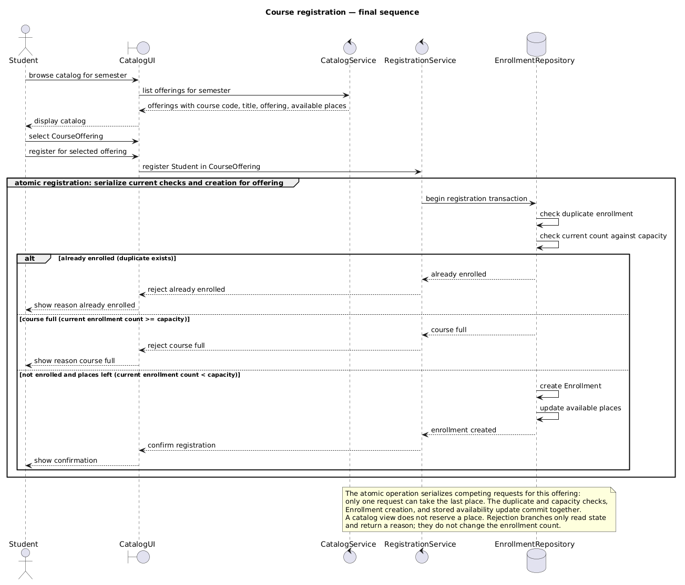
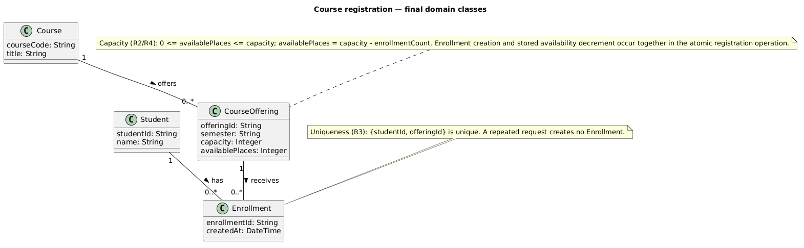
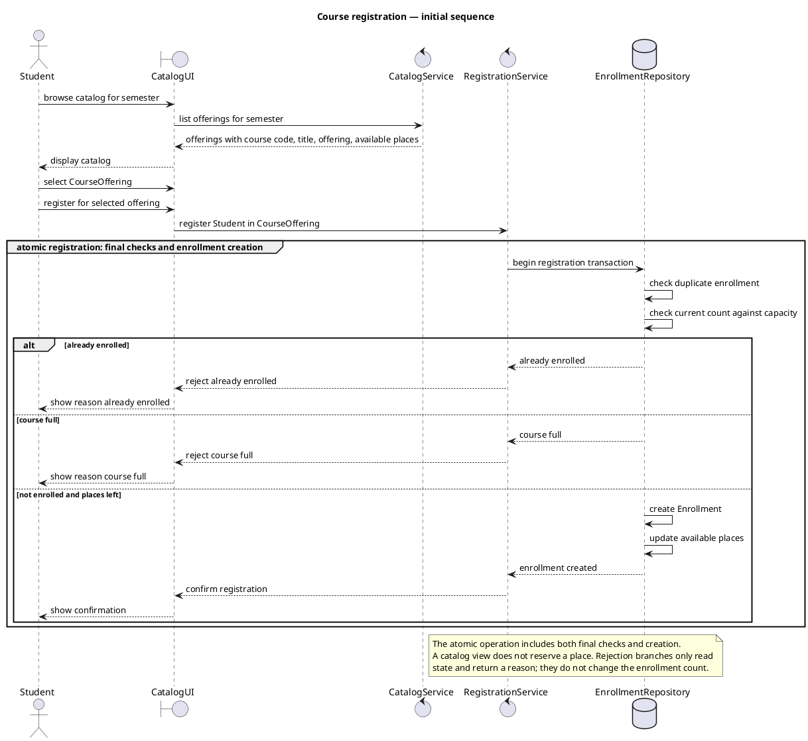
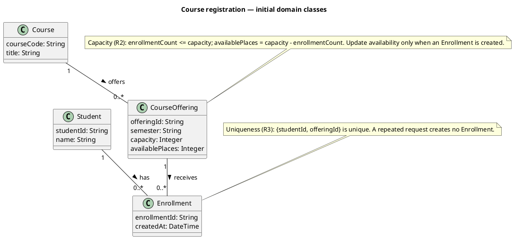
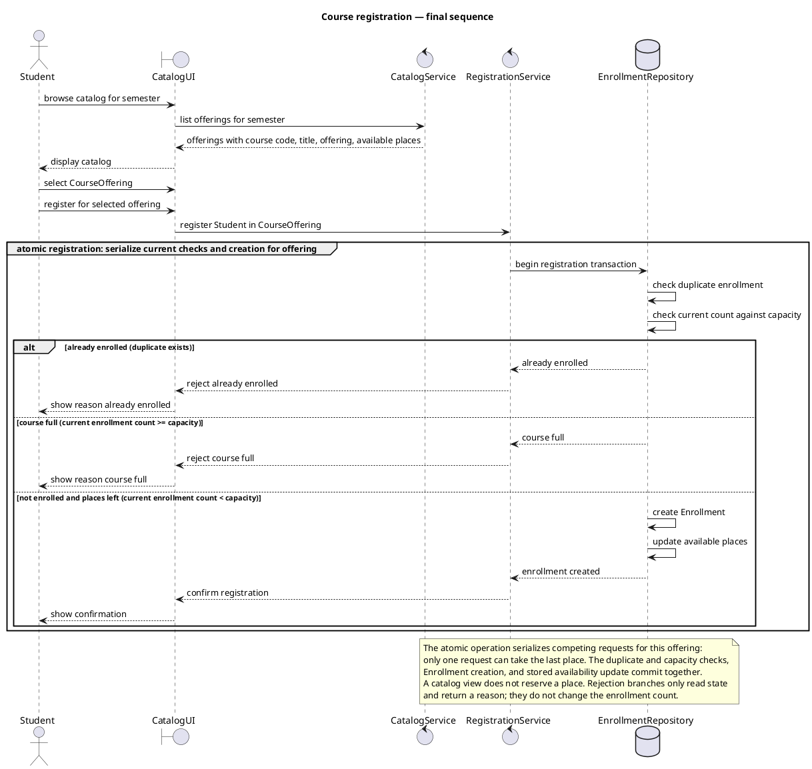
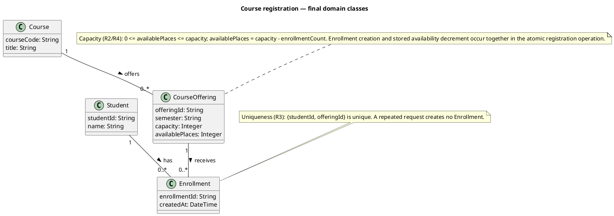
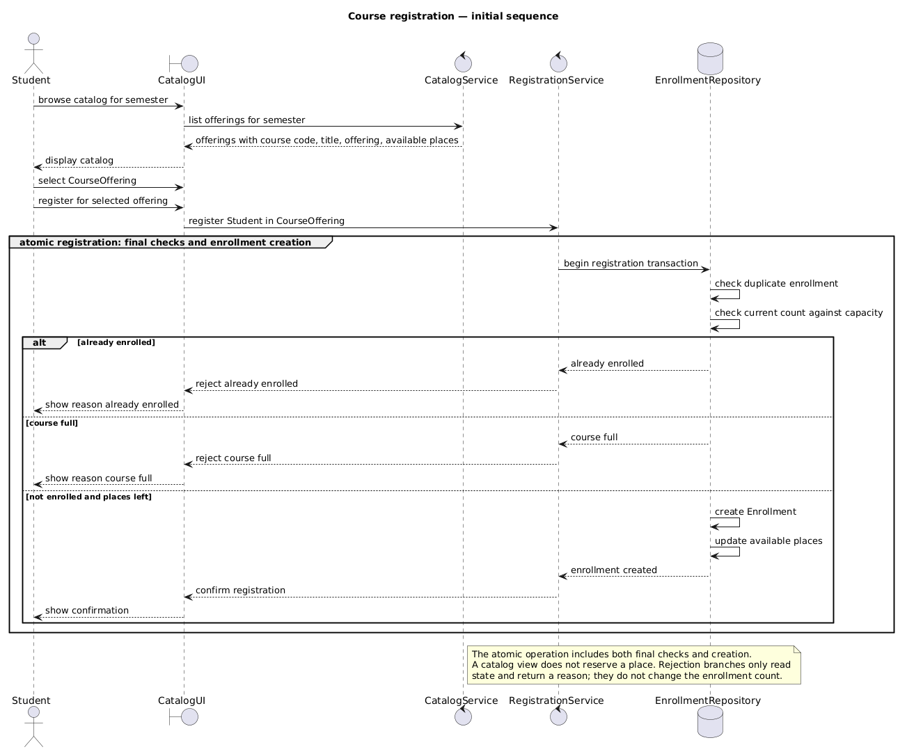
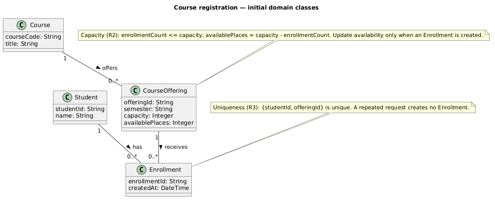

# SIS #02 — AI-Assisted UML Modeling: University Course Registration

<!--
  This is the only file you write your report in. README.md tells you what goes where.

  Rules the checker relies on:
  - Do not delete, rename or renumber the ## headings, the ### headings, or the **Label:** words.
  - Replace every "(write here)" and "(paste here)". None may be left when you submit.
  - Comments like this one are ignored by the checker and the word counter. Delete them or leave them.
-->

## 1. Scope and assumptions

<!-- Your FINAL scope statement and assumptions, after reviewing Prompt A's output. Say here
     what is out of scope (payments, prerequisites, timetable clashes, waiting lists,
     cancellation) — section 2 must not mention them. Section 10 keeps your first version. -->

**Scope:** The system lets signed-in students browse one semester's course offerings and request registration for a specific offering, returning confirmation or a rule-based rejection. Payments, prerequisites, timetable clashes, waiting lists, and cancellation are outside this system's scope.

**Assumptions:**

1. Students are already signed in; their active session identifies the student.
2. The selected offering exists, and its capacity is a positive whole number.

## 2. User stories and acceptance criteria

<!-- Your APPROVED requirements: Prompt A's draft after your review. Keep the IDs, the three
     story headings and the bullet shape. Every criterion names the rule(s) it maps to,
     e.g. (R2, R4). Two criteria per story. Nothing out of scope.
     Format of a criterion, on one bullet:
     - **AC-03** (R2, R4): Given ..., When ..., Then ... -->

### US-01 — Browse offerings

**US-01:** As a student, I want to browse the course offerings for one semester, so that I can choose a specific offering to request.

- **AC-01** (R1): Given the student is viewing the catalog for one semester, When the catalog is displayed, Then each offering shows its course code, title, offering, and available places.
- **AC-02** (R1): Given the catalog contains offerings for the selected semester, When the student chooses an offering, Then the chosen item is a specific CourseOffering in that semester.

### US-02 — Register for an offering

**US-02:** As a student, I want to request registration in a specific offering, so that my place is recorded when capacity allows.

- **AC-03** (R2, R4): Given I am not enrolled and the offering has a place at registration time, When I request registration, Then exactly one Enrollment linking me to that offering is created, availability is updated, and confirmation is returned.
- **AC-04** (R2, R4): Given exactly one place remains and I am not enrolled, When I request registration, Then the request succeeds and the resulting enrollment count equals, but does not exceed, capacity.

### US-03 — Receive a clear rejection

**US-03:** As a student, I want a clear reason when registration is rejected, so that I know whether the offering is full or I am already enrolled.

- **AC-05** (R2, R5): Given the catalog showed a place but the offering is full when registration is processed, When I request registration, Then the system explains "course full", creates no Enrollment, and leaves the enrollment count unchanged.
- **AC-06** (R3, R5): Given I am already enrolled in the same offering, When I request registration again, Then the system explains "already enrolled", creates no Enrollment, and leaves the enrollment count unchanged.

## 3. Sequence diagram

<!-- The FINAL diagram, rendered. Change .png to .svg if that is what you exported. -->



**Participants:** Student is the authenticated actor; CatalogUI represents the student-facing interface; CatalogService returns semester offerings; RegistrationService coordinates the request; EnrollmentRepository performs the atomic current-state checks and writes.

**Atomic operation:** The `atomic registration` group includes `check duplicate enrollment`, `check current count against capacity`, `create Enrollment`, and `update available places`. It serializes requests per offering so the last place cannot be claimed twice. Browsing only displays a snapshot and reserves no place.

**Where the Enrollment is created:** `EnrollmentRepository` sends `create Enrollment` in the successful alternative; it creates the `Enrollment` domain object shown in section 4.

**Technical lifelines:** CatalogUI, CatalogService, RegistrationService, and EnrollmentRepository are interaction and persistence components rather than domain classes. Their implementation roles complement, rather than duplicate, the domain concepts in the class diagram.

## 4. Class diagram

<!-- The FINAL diagram, rendered. -->



<!-- One row per association in classes.puml, read in both directions. -->

| Association | Read left to right | Read right to left |
| --- | --- | --- |
| Student — Enrollment | One Student has zero or more Enrollments. | Each Enrollment links to exactly one Student. |
| CourseOffering — Enrollment | One CourseOffering receives zero or more Enrollments. | Each Enrollment targets exactly one CourseOffering. |
| Course — CourseOffering | One Course may be offered in zero or more CourseOfferings. | Each CourseOffering describes exactly one Course. |

**How an Enrollment links a student to an offering:** Each Enrollment has a one-to-one link to one Student and one CourseOffering; the two associations together identify who registered in which scheduled section.

**Capacity constraint:** For each offering, `0 <= availablePlaces <= capacity` and `availablePlaces = capacity - enrollmentCount`. Creation and availability decrement occur together atomically. Multiplicity counts links but cannot impose a numeric limit tied to a capacity attribute.

**Uniqueness constraint:** The `{studentId, offeringId}` pair is unique across Enrollments. Multiplicity does not prohibit two different Enrollment objects linking the same student and offering, so this constraint is stated separately.

## 5. Traceability

<!-- Every rule, including the catalog fields and availability (R1). Column 1: the rule and
     the criteria that cover it, e.g. "R2 + AC-03, AC-04". Column 2: the message, guard,
     class or constraint that shows the rule in YOUR diagrams. Column 3: the T-ID that
     exercises it, or the extra check you did instead (R1 has no T case). -->

| Rule and criterion | Model evidence | Validation case |
| --- | --- | --- |
| R1 + AC-01, AC-02 | CatalogService returns course code, title, semester offering, and available places before a specific CourseOffering is selected. | Extra catalog inspection |
| R2 + AC-03, AC-04, AC-05 | Atomic group rechecks current enrollment count; guards distinguish count >= capacity from count < capacity; class note bounds availability by capacity. | T1, T2, T3 |
| R3 + AC-06 | Duplicate check precedes the capacity branch; class note makes studentId + offeringId unique. | T4 |
| R4 + AC-03, AC-04 | Successful branch creates one Enrollment, updates available places, then confirms registration. | T1, T2 |
| R5 + AC-05, AC-06 | Full and duplicate alternatives return their reason and have no creation or availability update. | T3, T4 |

## 6. Walkthroughs

<!-- Walk each case through YOUR final sequence diagram, message by message. Column 2: the
     actual steps and the state change (count before → after). Column 3 starts with Pass or
     Fail, then the location: the message, guard or note where you saw it. A Fail you
     report honestly is a finding, not a penalty. -->

| Case | Observed path and state change | Judgment and evidence |
| --- | --- | --- |
| T1. Available | Student → CatalogUI `browse catalog for semester`; CatalogUI → CatalogService `list offerings for semester`; CatalogService → CatalogUI returns code, title, offering and places; CatalogUI → Student `display catalog`; Student → CatalogUI selects CourseOffering and requests registration; CatalogUI → RegistrationService `register Student in CourseOffering`; RegistrationService → EnrollmentRepository begins transaction; repository checks duplicate (none), then count 0 < capacity 2; it `create Enrollment`, `update available places`, returns enrollment created; RegistrationService → CatalogUI `confirm registration`; CatalogUI → Student shows confirmation. Count 0 → 1. | Pass — success alternative and atomic note; creation precedes confirmation. |
| T2. Last place | Student → CatalogUI browses; CatalogUI → CatalogService lists offerings and returns catalog details; Student selects and requests registration; CatalogUI → RegistrationService registers the student/offering; RegistrationService → EnrollmentRepository begins transaction; repository checks duplicate (none), then current count 1 < capacity 2; it `create Enrollment`, `update available places` to zero, returns enrollment created; RegistrationService confirms; CatalogUI shows confirmation. Count 1 → 2. | Pass — success alternative uses count < capacity, including the last place. |
| T3. Full | CatalogService previously returned an offering showing a place; Student selects and requests registration through CatalogUI; RegistrationService → EnrollmentRepository begins transaction; repository checks duplicate (none), then current count 2 >= capacity 2; it returns `course full`; RegistrationService → CatalogUI `reject course full`; CatalogUI → Student `show reason course full`. No creation or update. Count 2 → 2. | Pass — course full alternative returns the reason; no state-changing message occurs. |
| T4. Duplicate | Student browses/selects through CatalogUI and requests registration; CatalogUI → RegistrationService registers the student/offering; RegistrationService → EnrollmentRepository begins transaction; repository finds the existing student/offering enrollment in `check duplicate enrollment`; it returns `already enrolled`; RegistrationService → CatalogUI rejects and CatalogUI → Student shows the reason. No creation or update. Count 1 → 1. | Pass — already enrolled alternative returns the reason; no state-changing message occurs. |

## 7. Review decisions

<!-- At least three substantive decisions about Prompt C's critique or your own inspection.
     Decision: accepted / rejected / modified — and what you did. Reason: why, in a full
     sentence. Rule: R1–R5. Do not invent an error to fill the table; a justified rejection
     of advice counts. -->

| AI suggestion or model element | Decision | Reason | Rule |
| --- | --- | --- | --- |
| Original alternatives named outcomes without current count/capacity boundaries. | Modified | Explicit current-count conditions separate full rejection from success, including when exactly one place remains. | R2, R5 |
| Availability was described by a formula and separately updated without saying whether it was stored. | Accepted | The final class model treats availablePlaces as stored and the sequence updates it together with Enrollment creation. | R2, R4 |
| An atomic label alone did not explain how concurrent requests are serialized. | Modified | The atomic operation states per-offering serialization without imposing a database or lock technology. | R2, R3, R4 |

## 8. Modeling explanation

<!-- 200–300 words. Your main design choices; how the class diagram and the sequence diagram
     complement each other; why an activity diagram could also help explain the workflow. -->

The sequence diagram focuses on the order of interactions: a student first requests a semester catalog, then selects a particular CourseOffering and submits registration. The catalog response includes code, title, offering identity and available places, but that view is only a snapshot. EnrollmentRepository performs the final duplicate and capacity checks against current state within the atomic operation. The explicit alternatives distinguish an existing enrollment, a full offering, and a request with a place available. Only the success path creates an Enrollment, decrements the stored availability, and returns confirmation; both rejection paths return a reason without changing enrollment state. Per-offering serialization makes the last-place boundary explicit for competing requests.

The class diagram complements that interaction view with stable domain structure. Course describes the subject; CourseOffering identifies a semester-specific section with capacity and available places. Enrollment connects exactly one Student to exactly one CourseOffering, while associations also show that each may have multiple enrollments. The capacity and unique student/offering constraints are separate notes because ordinary multiplicities cannot express a changing numeric capacity or prohibit repeated pairs.

An activity diagram could show the same decision flow as actions and branches, making the success and rejection paths easy to follow at a glance. It would be especially useful for explaining validation alternatives without lifeline timing. It would not replace the sequence diagram's ordering of messages or the class diagram's persistent domain relationships, so it would be an additional workflow view rather than a substitute.

## 9. Reflection

<!-- 150–200 words. Written by you, not by the assistant: where AI helped, one decision you
     made yourself, one remaining limitation. Specific beats flattering. -->

Throughout this assignment, the AI assistant proved exceptionally helpful during initial requirement drafting and PlantUML boilerplate generation. It rapidly mapped rules R1–R5 into structured Given/When/Then acceptance criteria and drafted initial sequence and domain class diagrams, significantly accelerating the baseline setup phase.

However, I made a critical modeling decision myself prior to using any AI by establishing in my Section 10 baseline that final capacity re-checking and enrollment creation must execute as a single atomic operation. When reviewing the assistant's generated requirements and diagrams, I explicitly approved and enforced this atomic requirement to prevent race conditions during concurrent registration attempts for the last available seat, while rejecting any extraneous features like payments or waitlists.

One remaining limitation of the current design is that it does not model transient system failures, concurrent locking timeouts, or background queueing mechanisms. Under extremely high user load during peak registration periods, relying strictly on direct synchronous atomic checks without an asynchronous waiting list could lead to database connection bottlenecks.

## 10. Appendix A — Before AI

<!-- Written BEFORE you run Prompt A, committed and pushed in your first commit, and never
     edited afterwards. This is what you paste into Prompt A as "My initial assumptions". -->

**Scope:** The system allows authenticated students to view course availability, select specific course offerings, and attempt registration, handling both successful enrollments and rejections due to capacity limits or duplicate requests, while excluding payment processing, prerequisite validation, schedule conflict checking, and waitlists.

**Initial assumptions:**

1. **Assumption 1 (Authentication & Session State):** The student is already securely authenticated in the system, and their active session provides a valid student ID to the registration process without requiring re-authentication.
2. **Assumption 2 (Offering Existence & Positive Capacity):** The target course offering exists in the electronic catalog, and its maximum capacity is defined as a positive whole number greater than zero.
3. **Assumption 3 (Atomicity of Enrollment):** Capacity re-checking and enrollment creation are executed as a single atomic operation to prevent race conditions when multiple students request the last available seat simultaneously.

## 11. Appendix B — AI exchanges

<!-- Complete prompts and complete responses, as text — never screenshots. Paste each inside
     the ~~~~ block that follows its label: AI responses contain ``` PlantUML blocks, and
     ~~~~ keeps them from breaking this file. Prompts B and C: the prompt text first, then
     the material it refers to ("below", "these two") pasted under it, in the same block.
     You may add B5, B6 … after B4 if you ran more. -->

### B1 — Requirements (Prompt A)

- **Tool:** GitHub Copilot in VS Code
- **Model:** not displayed
- **Date:** 2026-10-18
- **Purpose:** draft 3 user stories and 6 acceptance criteria

<!-- Model: the exact model with its version, as the tool shows it (e.g. "GPT-5 Thinking",
     "Claude Sonnet 4.5"). If the tool does not show it, write: not displayed
     Date: YYYY-MM-DD -->

**Prompt:**

~~~~text
Act as a requirements analyst. Use only this course registration scenario and rules R1–R5: A student browses an electronic course catalog, chooses a course offering and requests registration. Each offering has a limited number of places.

A Course describes a subject. A CourseOffering is one scheduled section in one semester. Registration always targets a specific offering.

Assume that the student is signed in, the selected offering exists, and its capacity is a positive whole number.

Exclude payments, prerequisites, timetable clashes, waiting lists and cancellation. Use fictional students and courses.

R1. Catalog: Show the course code, title, offering and available places for one semester.
R2. Capacity: Recheck current availability when registering. Enrollment must never exceed the offering's capacity.
R3. Duplicates: A student may have at most one enrollment in the same offering. Reject a repeat request.
R4. Success: Create exactly one Enrollment linking the student and offering, update availability and return a confirmation.
R5. Rejection: Explain "course full" or "already enrolled". Create no enrollment and leave the enrollment count unchanged.

My initial assumptions are 1. The student is already securely authenticated in the system, and their active session provides a valid student ID to the registration process without requiring re-authentication. 2. The target course offering exists in the electronic catalog, and its maximum capacity is defined as a positive whole number greater than zero. 3. Capacity re-checking and enrollment creation are executed as a single atomic operation to prevent race conditions when multiple students request the last available seat.
Draft 3 user stories and 2 Given / When / Then acceptance criteria for each. Use IDs US-01 to US-03 and AC-01 to AC-06. Map each criterion to rule IDs.
Cover normal and rejection behavior. List uncertainty separately. Do not add excluded features or invent university policies.
~~~~

**Response:**

~~~~text
### US-01 — Browse offerings

**US-01:** As a student, I want to browse the course offerings for one semester, so that I can choose a specific offering to request.

- **AC-01 (R1):** Given the student is viewing the catalog for one semester, When the catalog is displayed, Then each offering shows its course code, title, offering, and available places.
- **AC-02 (R1):** Given the catalog contains offerings for the selected semester, When the student chooses an offering, Then the chosen item is a specific CourseOffering in that semester.

### US-02 — Register for an offering

**US-02:** As a student, I want to request registration in a specific offering, so that my place is recorded when capacity allows.

- **AC-03 (R2, R4):** Given I am not enrolled and the offering has a place at registration time, When I request registration, Then exactly one Enrollment linking me to that offering is created, availability is updated, and confirmation is returned.
- **AC-04 (R2, R4):** Given exactly one place remains and I am not enrolled, When I request registration, Then the request succeeds and the resulting enrollment count equals, but does not exceed, capacity.

### US-03 — Receive a clear rejection

**US-03:** As a student, I want a clear reason when registration is rejected, so that I know whether the offering is full or I am already enrolled.

- **AC-05 (R2, R5):** Given the catalog showed a place but the offering is full when registration is processed, When I request registration, Then the system explains "course full", creates no Enrollment, and leaves the enrollment count unchanged.
- **AC-06 (R3, R5):** Given I am already enrolled in the same offering, When I request registration again, Then the system explains "already enrolled", creates no Enrollment, and leaves the enrollment count unchanged.

**Uncertainty:** The rules do not prescribe catalog filtering or sorting, confirmation wording, or implementation technology. Those details are left unspecified rather than treated as additional policy.
~~~~

### B2 — UML drafts (Prompt B)

- **Tool:** GitHub Copilot in VS Code
- **Model:** not displayed
- **Date:** 2026-10-18
- **Purpose:** draft the sequence and class diagrams

**Prompt:**

~~~~text
Using my approved scenario, R1–R5, stories and criteria below, return separate PlantUML code blocks for a sequence diagram and a domain class diagram.
Sequence: include catalog browsing and guarded success, full-course and duplicate outcomes. Model final checks and creation as one atomic operation.
Class: show domain concepts, useful attributes and multiplicities. State the capacity and uniqueness constraints. Explain assumptions and any technical lifelines.

### US-01 — Browse offerings

**US-01:** As a student, I want to browse the course offerings for one semester, so that I can choose a specific offering to request.

- **AC-01 (R1):** Given the student is viewing the catalog for one semester, When the catalog is displayed, Then each offering shows its course code, title, offering, and available places.
- **AC-02 (R1):** Given the catalog contains offerings for the selected semester, When the student chooses an offering, Then the chosen item is a specific CourseOffering in that semester.

### US-02 — Register for an offering

**US-02:** As a student, I want to request registration in a specific offering, so that my place is recorded when capacity allows.

- **AC-03 (R2, R4):** Given I am not enrolled and the offering has a place at registration time, When I request registration, Then exactly one Enrollment linking me to that offering is created, availability is updated, and confirmation is returned.
- **AC-04 (R2, R4):** Given exactly one place remains and I am not enrolled, When I request registration, Then the request succeeds and the resulting enrollment count equals, but does not exceed, capacity.

### US-03 — Receive a clear rejection

**US-03:** As a student, I want a clear reason when registration is rejected, so that I know whether the offering is full or I am already enrolled.

- **AC-05 (R2, R5):** Given the catalog showed a place but the offering is full when registration is processed, When I request registration, Then the system explains "course full", creates no Enrollment, and leaves the enrollment count unchanged.
- **AC-06 (R3, R5):** Given I am already enrolled in the same offering, When I request registration again, Then the system explains "already enrolled", creates no Enrollment, and leaves the enrollment count unchanged.
~~~~

**Response:**

~~~~text
The sequence diagram separates browsing from registration. The catalog response includes the required course code, title, offering and available-place information, while the later registration request is handled by RegistrationService. EnrollmentRepository represents the persistence boundary where current facts can be checked rather than trusting the earlier catalog view.

The atomic group contains the duplicate check, current capacity check, and conditional creation/update. The alternatives are mutually exclusive: already enrolled, course full, or not enrolled with places left. Only the final branch creates an Enrollment, updates available places, and returns confirmation. Rejections return their reasons without a write.

The class diagram uses Student, Course, CourseOffering and Enrollment. CourseOffering carries its semester and capacity; availablePlaces is maintained when an enrollment is created. Each Enrollment connects one Student and one CourseOffering, while each Course may have zero or more offerings. The notes state the capacity and uniqueness rules because simple association multiplicities cannot express either constraint.

The technical lifelines CatalogUI, CatalogService, RegistrationService and EnrollmentRepository describe interaction and storage responsibilities; they are not domain classes. Assumptions are that a student is already identified, the offering exists, and capacity is positive, as stated in the scenario. The sequence models a single transaction-like atomic operation and does not prescribe a database or concurrency implementation. The constraints refer to the same offering and semester throughout, and no additional policy is introduced.




~~~~

### B3 — Model critique (Prompt C)

- **Tool:** GitHub Copilot in VS Code (new chat)
- **Model:** not displayed
- **Date:** 2026-10-18
- **Purpose:** review both models against R1–R5 and T1–T4

**Prompt:**

~~~~text
Review these two UML models against R1–R5 and my acceptance criteria. Check message order, guards, state changes, multiplicities and naming.
Inspect the four validation cases: available places, exactly one place, full course after a stale catalog view, and duplicate registration.
For each issue, cite the affected rule and model element. Explain the impact and propose a focused correction. Separate genuine defects from optional design choices.

Approved acceptance criteria:
- AC-01 (R1): Given the student is viewing the catalog for one semester, When the catalog is displayed, Then each offering shows its course code, title, offering, and available places.
- AC-02 (R1): Given the catalog contains offerings for the selected semester, When the student chooses an offering, Then the chosen item is a specific CourseOffering in that semester.
- AC-03 (R2, R4): Given I am not enrolled and the offering has a place at registration time, When I request registration, Then exactly one Enrollment linking me to that offering is created, availability is updated, and confirmation is returned.
- AC-04 (R2, R4): Given exactly one place remains and I am not enrolled, When I request registration, Then the request succeeds and the resulting enrollment count equals, but does not exceed, capacity.
- AC-05 (R2, R5): Given the catalog showed a place but the offering is full when registration is processed, When I request registration, Then the system explains "course full", creates no Enrollment, and leaves the enrollment count unchanged.
- AC-06 (R3, R5): Given I am already enrolled in the same offering, When I request registration again, Then the system explains "already enrolled", creates no Enrollment, and leaves the enrollment count unchanged.

Original sequence.puml:


Original classes.puml:

~~~~

**Response:**

~~~~text
## Blocking issues

None. The sequence and class models cover the four requested cases at a conceptual level, and the class multiplicities are consistent with an Enrollment linking one Student to one CourseOffering.

## Non-blocking issues

1. The branch conditions do not make the capacity boundary explicit. Affected rules: R2/R5; AC-03, AC-04, AC-05. Model element: the sequence alternatives "course full" and "not enrolled and places left." The labels imply outcomes but do not define the conditions against current state, including the exactly-one-place boundary. Focused correction: state conditions based on the current enrollment count and capacity, so one remaining place succeeds and a full offering rejects.

2. Availability is described as derived and updated as separate state. Affected rules: R2/R4; AC-03 and AC-04. Model elements: CourseOffering.availablePlaces and the formula availablePlaces = capacity - enrollmentCount, plus the sequence message "update available places." If derived, the update duplicates enrollment creation; if stored, the model should specify that count and creation change together. Focused correction: choose one representation and make the update atomic with Enrollment creation.

3. "Atomic" alone does not guarantee concurrent capacity checks are safe. Affected rules: R2/R4, especially AC-04. Model element: the atomic registration group and "check current count against capacity." Two simultaneous requests could both observe the final place unless the operation prevents that race. Focused correction: specify serialized or conditional capacity checking and enforce duplicate uniqueness at persistence.

## Validation cases

- Places available: the success branch creates an Enrollment, updates availability, and returns confirmation, matching AC-03 conceptually; the explicit guard and availability representation remain underspecified.
- Exactly one place: the model intends success, but "places left" does not define the boundary. Use a current-state condition such as enrollmentCount < capacity.
- Full after a stale catalog view: the repository checks the current count, and the full branch returns "course full" without a creation or availability update. This matches AC-05, subject to the concurrency caveat.
- Duplicate registration: the duplicate check precedes the capacity check, so an existing enrollment receives "already enrolled" even if full. No state-changing message appears in that branch, matching AC-06.

## Multiplicities and naming

The multiplicities correctly show that every Enrollment links to exactly one Student and one CourseOffering, while each may have zero or more enrollments. The Course-to-CourseOffering relationship is consistent. CourseOffering selection and registration align with the class model; no naming defect stands out.
~~~~

### B4 — Focused revision (Prompt D)

- **Tool:** GitHub Copilot in VS Code
- **Model:** not displayed
- **Date:** 2026-10-18
- **Purpose:** apply my accepted review decisions

**Prompt:**

~~~~text
Revise the UML sources using only my accepted review decisions: 1. Make sequence alternatives state the current enrollment-count/capacity boundary so exactly one remaining place succeeds and a full offering rejects. 2. Keep availablePlaces as stored state and make its update atomic with Enrollment creation. 3. Clarify that registration requests for one offering are serialized, so concurrent requests cannot take the same last place; retain the unique student/offering constraint. Keep justified existing elements and explain each change.
Preserve the agreed scope and rule IDs. Return both updated PlantUML blocks and a concise change log. Flag any unresolved issue.
Approved requirements:
### US-01 — Browse offerings
**US-01:** As a student, I want to browse the course offerings for one semester, so that I can choose a specific offering to request.
- **AC-01 (R1):** Given the student is viewing the catalog for one semester, When the catalog is displayed, Then each offering shows its course code, title, offering, and available places.
- **AC-02 (R1):** Given the catalog contains offerings for the selected semester, When the student chooses an offering, Then the chosen item is a specific CourseOffering in that semester.
### US-02 — Register for an offering
**US-02:** As a student, I want to request registration in a specific offering, so that my place is recorded when capacity allows.
- **AC-03 (R2, R4):** Given I am not enrolled and the offering has a place at registration time, When I request registration, Then exactly one Enrollment linking me to that offering is created, availability is updated, and confirmation is returned.
- **AC-04 (R2, R4):** Given exactly one place remains and I am not enrolled, When I request registration, Then the request succeeds and the resulting enrollment count equals, but does not exceed, capacity.
### US-03 — Receive a clear rejection
**US-03:** As a student, I want a clear reason when registration is rejected, so that I know whether the offering is full or I am already enrolled.
- **AC-05 (R2, R5):** Given the catalog showed a place but the offering is full when registration is processed, When I request registration, Then the system explains "course full", creates no Enrollment, and leaves the enrollment count unchanged.
- **AC-06 (R3, R5):** Given I am already enrolled in the same offering, When I request registration again, Then the system explains "already enrolled", creates no Enrollment, and leaves the enrollment count unchanged.
Original sources:


My review decisions and evidence: Decision 1 accepted because the original branch labels did not state how a last place is distinguished from a full offering; the current count/capacity labels make T2 and T3 outcomes explicit. Decision 2 accepted because the original formula made availablePlaces sound derived even though a separate update message changed it; the final model treats it as stored state updated with creation. Decision 3 modified: the model states serialization per offering without selecting a database or lock technology, preserving the assignment's implementation-neutral scope while addressing the race described under R2.
~~~~

**Response:**

~~~~text
## Change log

1. Added current-state capacity conditions to the sequence alternatives: a count at or above capacity rejects as full, while a count below capacity includes the last-place success case.
2. Clarified that availablePlaces is stored state, decremented in the same atomic registration operation as Enrollment creation.
3. Specified serialization of competing registration requests for the same offering, without choosing a database or implementation mechanism.
4. Kept the four required domain classes, associations, multiplicities, catalog browsing, rejection reasons, and uniqueness constraint. Rejections remain read-only.
5. No unresolved model issue remains within the stated scope; implementation details are intentionally not modeled.




~~~~

## 12. Appendix C — Original diagrams

<!-- The AI's first output from Prompt B, rendered unedited from models/original/. -->





## 13. Appendix D — References and source checks

### References

<!-- Full references, one per line, each starting with "- ". Only sources you actually opened.
     Every URL used in the source checks must also appear here. Example:
     - Sommerville, I. (2016). Software Engineering, 10th ed., Global Edition. Pearson. Ch. 5. -->

- PlantUML. "Sequence Diagram syntax and features." https://plantuml.com/sequence-diagram (accessed 2026-10-18).
- PlantUML. "Class Diagram syntax and features." https://plantuml.com/class-diagram (accessed 2026-10-18).

### Source checks

<!-- At least two modeling decisions you verified. Source and locator: title + slide, page,
     section, chapter or figure — or title + URL + access date (YYYY-MM-DD). Slide numbers
     refer to the decks posted in our Teams. -->

| Modeling decision | Source and locator | What the source says | How it supports or changed your model |
| --- | --- | --- | --- |
| Use guarded alternatives for the success, full, and duplicate sequence paths. | PlantUML, "Sequence Diagram syntax and features," https://plantuml.com/sequence-diagram, accessed 2026-10-18. | The sequence documentation lists `alt/else` among the grouping constructs for conditional paths. | It supports using alternatives to separate the mutually exclusive results; the R2/R3 conditions still come from the assignment rules. |
| State multiplicity at both ends of each domain association. | PlantUML, "Class Diagram syntax and features," https://plantuml.com/class-diagram, accessed 2026-10-18. | The class-diagram documentation supports double-quoted cardinalities on each side of a relation. | It supports the `1` and `0..*` notation in the association ends; capacity and uniqueness remain separate constraints. |
